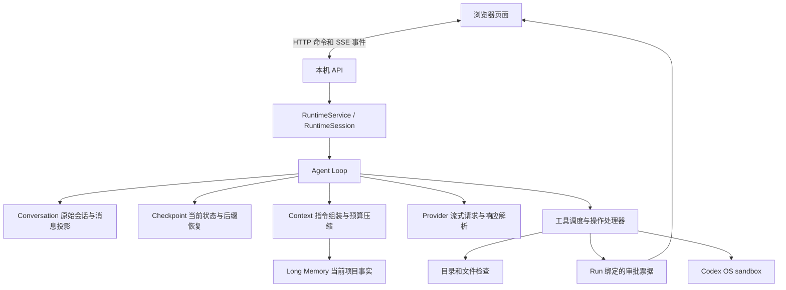

# minicode 模块边界与执行流程

## 为什么这样拆

Conversation 记录“发生过什么”，Context 决定“本次模型能看到什么”，两者不能共享一个会被摘要覆盖的消息列表。Checkpoint 接管当前状态并保存恢复游标，独立 ShortMemory 已移除，不再创造另一套状态存储。Long Memory 负责筛选跨会话信息，不在读取会话时自动猜测偏好。

Provider 属于 Runtime：它只传输请求和解析响应，不应该存在 conversation 中。Context 的辅助压缩请求仍由 Runtime 的 auxiliary 调用接口承担；Context 负责压缩目标与结果是否可以被采用。工具执行器不构造模型提示词，审批服务不负责页面键盘事件。

一个源文件按一个工程职责组织，而不是机械要求每个文件只有一个函数。工具注册/调度、读文件、搜索、文件变更、技能、Shell 分别维护；领域内部也将预算、提示词、摘要缓存和压缩分开。

## 请求与事件

前端提交任务后，先将输入原文、run/turn 身份与冻结配置可靠保存，再返回 run ID，任务由后端 asyncio Task 管理。浏览器的流连接断开只结束观察者，不取消任务。SSE 从持久会话事件序号之后重放；刷新先加载当前快照再接上后续事件，避免遗漏中间输出。

审批票据由后端生成，只能由对应会话和 run ID 消费一次，等待超时后拒绝。执行中禁止变更当前目录和技能；提示词编辑要求全部任务停下。批准后文件工具再校验授权版本、路径和文件指纹。

原始存储路径沿用 `.minicode/sessions/<ID>/session.jsonl`。`checkpoint.json` 保存带完整性校验的状态、日志位置与运行投影。有效快照通过 schema/reducer 版本、日志身份与边界记录校验后，从字节偏移读取后续事件；坏/旧快照回退完整日志。旧 task_state 事件仍可迁移，旧 task_state.json 不再读写。完整审计按需读取原日志；未完成轮次被标为 interrupted。历史投影补全缺失的工具结果为未知状态，不自动重跑。

## 长期记忆

每轮完成后只提交本轮用户消息给提取器。模型提出主题与原文引用，程序验证引用确实出现在源消息中，然后按项目路径与主题合并。保留 message/session/time/version；更新以用户陈述时间为准，删除使用代际 tombstone 防止较早的后台任务复活条目。

后台总结不依赖浏览器关闭。关闭后端时取消未提交的记忆任务；当前没有持久提取队列，因此异常退出时可能遗漏这次后台总结，但原消息仍在。这是后续可靠性工作的边界，不能称为 durable execution。

## 模型能力解析

`backend/models/capabilities.py` 定义带来源的窗口、输出和输入上限；`metadata.py` 读取服务端扩展字段；`catalog.py` 按端点和完整模型名匹配 Models.dev；`cache.py` 保存 24 小时有效缓存；`resolver.py` 合并能力与应用输出预留。`config.py` 只读取配置并校验，不访问网络。启动入口在创建 Runtime 前解析能力，解析失败不启动任务。

标准 OpenAI Models API 不包含窗口字段，因此目录查询是必要的补充，而且不能包装成官方实时能力接口。未知网关需明确目录服务商映射；模型名不做前缀猜测。原生 OpenAI 调用采用 Chat Completions 与 `max_completion_tokens`，兼容端点使用 `max_tokens`。

## 上下文

每次调用重新组装固定规则、目录能力、全局和相关项目提示词、技能描述、当前项目记忆、历史消息。输入预算扣除最大输出预留；80% 开始尝试摘要，保留最新用户请求与近期完整 assistant/tool 组。摘要必须更小、符合预算且工具配对完整，失败则保留原输入并在超预算时暂停。

持久摘要缓存存 source length/digest 和受预算约束的 prepared history。恢复时原历史前缀必须匹配；系统规则始终重新生成。它是输入缓存，不是原始会话的替代，也不是任意副作用的恢复点。

## Shell

参考 [Codex 安全模型](https://developers.openai.com/codex/security)、[官方沙箱 CLI 实现](https://github.com/openai/codex/blob/main/codex-rs/cli/src/debug_sandbox.rs) 与 [权限类型](https://github.com/openai/codex/blob/main/codex-rs/protocol/src/models.rs)。本项目通过 CLI 提供的明确 PermissionProfile JSON 复用沙箱构造，而不是根据命令黑名单声称完成隔离。

策略为 managed/restricted，允许最小系统读取和授权目录写入，拒绝应用及敏感路径，禁用网络。启动探针在一次性临时目录检查关键边界。Shell 进程使用过滤环境，输出上限、超时和取消由执行模块管理；终止不确定时保留暂停状态。

该执行策略较保守：授权范围外的依赖、用户工具链或缓存也可能不可读/写；联网安装依赖默认失败。不能为了让命令成功退回无隔离执行，后续可显式增加只读运行时依赖授权或有审批的网络策略。

## 前端选择与局限

界面参考 OpenCode 的白色应用布局，使用浅灰导航、居中的新会话输入区和按需打开的工作区；不使用字母商标。设计过程参考 [Anthropic frontend-design](https://github.com/anthropics/skills/blob/main/skills/frontend-design/SKILL.md)，以实际浏览器截图复核留白与可读性。

当前用 HTML/CSS/JavaScript ES modules，因此没有 Node/Vite 编译步骤，浏览器直接加载模块。HTTP/SSE 接口与领域层独立，可在下一轮换成 React。保留轻量 Web 入口比引入桌面壳更符合本轮 demo 重构范围。

本机令牌、Host/Origin 校验与 CSP 防止第三方页面随意调用控制 API；不防御已能读取本机进程/文件的恶意用户，不提供远程多人身份体系。

本轮不新增 trace/span 观测系统、评测数据集、检索或多 Agent；没有未经实验的延迟、成本、成功率指标。

## 本地执行与 MySQL

本地工具批次使用同一用户下的协作式 OS 锁，批次内安全读取仍可并行。副作用前保存持久执行标记，已知结果先落盘再清理标记。UNKNOWN 保留标记以阻塞其他协作会话；人工确认旧进程停止后，在锁内保存 operation_reconciled，再解除阻塞。外部非协作进程仍不受此锁控制，文件版本检查不能省略。

MySQL 已接入 RuntimeService / RuntimeSession，沿用同一事件和快照语义。短事务原子保存事件与状态/操作投影，LLM、Shell 和文件 I/O 始终在事务外。数据库动作使用有界线程池，同会话序号及 owner 校验保持顺序，持久工作区占用协调冲突。共享 OS 协调和持久执行域限制防止本地模式或另一数据库绕过未知操作。配置和实际验证范围见 [MySQL 协议](mysql.md)，本地细节见 [检查点恢复协议](checkpoint-recovery.md)。
