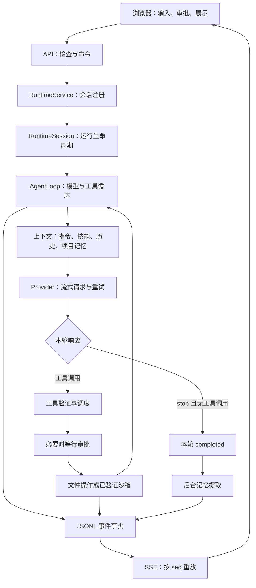

# 当前 Harness 与执行轨迹设计

检查日期：2026-10-08。基于本轮本地工作区，而非旧目录或粘贴计划中的历史实现。
前端布局和等待提示已修改；本文中的轨迹模块、事件字段、接口和验收状态是下一阶段提案，尚未实现。

## 1. 当前系统的职责边界

Harness 是围绕模型的运行控制系统：接收输入、选取上下文、调用模型、执行工具、审批、持久化、取消和恢复。模型负责提出回复及工具调用，程序负责决定调用是否允许、如何执行及保存证据。

| 层 | 当前入口 | 实际职责 |
|---|---|---|
| 浏览器 | `frontend/app.js`, `api.js`, `messages.js` | 提交输入，读取快照，订阅 SSE，展示回复及审批 |
| API | `backend/api/routes.py`, `security.py`, `events.py` | 本地同源与令牌检查、参数验证、运行命令、事件重放 |
| 应用 | `backend/runtime/service.py` | 配置、共享 Provider/长期记忆、沙箱验证、会话注册与关闭 |
| 会话 | `backend/runtime/session.py` | 日志、授权、审批、上下文、工具和后台 asyncio Task 的生命周期 |
| 主循环 | `backend/runtime/loop.py` | 新轮次、构建请求、处理模型输出、调度工具、决定本轮终止 |
| 对话 | `backend/conversation/` | 原始事件、消息投影、协议配对、崩溃恢复 |
| 上下文 | `backend/context/` | 固定规则、项目指令、技能、历史、预算、压缩及压缩缓存 |
| 记忆 | `backend/short_memory/`, `long_memory/` | 当前轮任务状态，按项目提取和注入用户明确记忆 |
| 工具 | `backend/tools/` | 输入 schema、只读并发、写屏障、文件版本检查、失败抑制 |
| 执行 | `backend/execution/`, `permissions/` | 路径边界、危险命令检查、已验证系统沙箱、进程捕获与取消 |
| 附件存储 | `backend/storage/output_store.py` | 长结果脱敏、外置、返回有限预览和引用 |

没有独立规划器、任务 DAG、验证器或独立的跨轮 task 实体。当前主控制流是单会话内串行的模型—工具循环；只读工具组可并发。



箭头表示主要职责和信息流；不是每条箭头都对应独立进程或网络请求。

## 2. 一次输入如何到达输出

1. `composer` 提交去除首尾空白后的文本。输入为空或当前会话运行中，前端不发送；服务端也会拒绝重入。执行期间输入框允许编辑下一轮草稿，但没有服务端输入队列。
2. `POST /api/sessions/{sid}/runs` 经过安全和参数检查，交给 `RuntimeSession.start(text)`。它生成 `run_id`、绑定审批并启动后台 Task，API 返回 202，浏览器连接不拥有任务生命周期。
3. `AgentLoop.run` 调用 `ConversationManager.start`，生成另一个 `turn_id`，追加 `turn_start` 和用户 `message`。
4. 重置本轮读取指纹、失败计数、技能执行状态等；从文本和授权目录选择项目范围；短期状态更新为本轮目标、running、请求数 0。
5. 每次循环重新组装固定规则、当前权限/执行能力、按活动项目筛选的长期记忆、技能目录、用户选定技能、全局和相关项目指令。
6. 从日志投影完整消息序列。普通文本、工具调用、工具结果进入模型上下文；原始流式碎片不重复作为完整消息加入。缺失工具结果会被投影为 unknown 观察，不能盲目重放。
7. `ContextManager.prepare` 深拷贝并估算消息和工具 schema 大小。低于输入预算 80% 时直接使用；否则尝试压缩可选旧消息，保留最近消息与最新用户输入，维持调用/结果分组完整。合格摘要写入日志，恢复时按源前缀摘要匹配复用；超预算且无法安全压缩则暂停。
8. 为该次响应生成 `message_id`；每次传输尝试生成 `request_id`，记录 `request_start` 与未知 usage，占用本轮 30 次主请求额度。
9. `Provider.complete` 发送流式请求。SSE 累加器分别拼接正文、reasoning 和工具参数；每段先追加日志，再唤醒浏览器 SSE。前端按 seq 去重，并在下一动画帧重绘。
10. 无输出的可重试错误最多尝试三次，当前延迟为 0.5 秒、1 秒；正文、思考或工具参数任何一项已开始输出后，不自动重试。
11. 正常响应保存完整 assistant message、工具调用、结束原因与 usage。只有完整工具参数才可进入调度。
12. 若有工具：校验 schema，连续只读调用最多四个一组，写操作和 Shell 串行；路径/内容/版本/权限检查在执行器和处理器中完成。修改和 Shell 等待单次、run 绑定的审批；批准后再次核对文件版本与授权。
13. 工具结果写日志，长结果外置；下一次循环把 assistant 工具调用和所有对应结果一起送回模型。一次用户输入因此可能产生多次模型请求。
14. `stop` 且无工具调用时，当前代码记为 `completed`，随后异步提取本轮用户明确记忆。它表示回复结束，还没有独立的任务验收通过证据。
15. 拒绝、取消、模型不完整返回、超预算或未知副作用走不同终止路径。取消保存部分输出；文件已发生的修改不会被撤销。

### 连续三轮的具体例子

下面是说明控制流的例子，并非本轮真实模型运行轨迹。

```text
同一 session S

用户 U1：定位登录报错，不修改文件
  run R1 / turn T1
    step A：构建上下文 → 模型提出 Glob、Grep
            → 只读工具组 → 工具结果持久化
    step B：历史 + 搜索结果 → 模型提出 ReadFile
            → 读取代码 → 记录读取指纹
    step C：历史 + 文件结果 → 模型回复原因 → turn_end(completed)

用户 U2：按刚才的方案修复
  run R2 / turn T2
    沿用 U1 及工具结果；更新目标；本轮请求计数从 0 开始
    上一轮的读取指纹已清空，修改前仍需本轮重新读文件
    step A：读取目标文件
    step B：EditFile → 展示差异 → 用户批准 → 重新核对版本 → 写入
    step C：模型选择 Shell 跑测试 → 用户批准 → 已验证沙箱执行
    step D：模型查看测试结果 → 回复结束

用户 U3：再补一个边界条件
  run R3 / turn T3
    保留前两轮消息和工具结果；如过长则使用合格摘要 + 近期消息
    重新读取、修改、审批、测试 → 回复结束
```

U2 之所以能理解“刚才”，主要依赖消息历史，未必依赖长期记忆。长期记忆是提取后的项目偏好和事实，不是聊天全文副本。后台提取未完成时，下一轮快照可能还没有新增记忆。

用户输入“继续”目前仍然是一个新 run、新 turn，依靠历史理解后续工作；没有恢复到上一轮的某个工作流程序位置。请求上限也会随新轮重置。已运行会话不能同时接收第二个 run，但不同会话能够独立运行。

浏览器断线重新订阅 SSE 不会新建 run；进程重启会恢复历史、将未终止轮次标为 interrupted，不会自动继续运行工具。特别是不能把“重放显示事件”写成“重放工具执行”。

## 3. 相对粘贴计划已经变化的内容

| 旧计划的判断 | 当前实际代码 | 剩余缺口 |
|---|---|---|
| 终端承担展示与部分运行职责 | 已有 Web API、后台会话 Task、可重放 SSE | 可供 Eval 使用的固定 headless 入口尚未建立 |
| 缺少独立任务状态 | `ShortMemory` 将 objective、status、turn_id、请求数、估算、pending_tool 写日志及快照 | 缺少阶段、跨轮 task 身份、剩余统一预算、covered_seq |
| 压缩只在内存复用 | `CompactionCache` 已持久化 prepared_history 与 source_digest | 仍全历史投影/深拷贝，没有失败冷却和最小收益阈值 |
| 长期记忆全量注入 | `ScopedMemory` 按活动授权项目或 unscoped 筛选 | 多项目混合任务的检索策略仍简单，历史不会因切换目录自动清空 |
| Shell 完全不可用 | 已接入 CodexSandbox，并有启动探针和环境变量过滤 | 条件是本机验证通过；不能由一台 macOS 的结果推断全部平台可用 |
| 无测试修复能力 | 模型可调用已验证 Shell，拿非零退出继续修改 | 没有自动测试策略、独立验收器或 repair 次数预算 |
| 无执行轨迹 | 已有很多原始 JSONL 证据及时间戳 | 缺统一关联、结束事件、耗时分解、导出和 Eval 判分 |

## 4. 本轮实际延迟诊断

样本：现存会话 `f44e816281da4aa69e365576fe7e113b` 的“你好”，一轮、一个主请求、没有重试。时间换算为 Asia/Shanghai：

| 事件 | 本地时间 | 距 turn_start |
|---|---|---:|
| 用户消息保存 | 22:46:26.666 | 0.002 秒 |
| 上下文估算保存 | 22:46:26.670 | 0.006 秒 |
| 主请求开始 | 22:46:26.672 | 0.008 秒 |
| 首段 reasoning 到达并写日志 | 22:46:38.217 | 11.554 秒 |
| 首段正文到达并写日志 | 22:46:39.206 | 12.544 秒 |
| 本轮结束 | 22:46:41.649 | 14.985 秒 |

请求开始到首段思考约 11.54 秒，思考首段到正文约 0.99 秒。主要等待在上游首段输出之前；日志无法区分连接、网络、排队与模型预处理/推理。这一轮不是反复调用、压缩或长时间本地准备导致。

上表是本地事件写入时刻，不是网络抓包和浏览器绘制时刻；首次正文显示的端到端延迟没有被完整采集。输入大小 7243 是保守估算，不是服务商 usage 中的实际 prompt_tokens。

官方说明 GLM-5.3-Flash 强制思考，不能简单发送 `thinking.type=disabled`。可比较 `reasoning_effort=low`，但它改变推理力度，不能保证消除上述首段等待；需要同请求内容多次 A/B 测量。本轮未修改模型请求配置或发起新的收费模型实验。

来源：[模型说明](https://docs.z.ai/guides/vlm/glm-5.3-flash)、[思考模式说明](https://docs.z.ai/guides/capabilities/thinking-mode)。

其他需要测量的风险：每个 delta 同步 fsync、非 delta 常重建元数据、每次传输创建新 HTTP client、每帧重绘历史。它们可能影响长任务或吞吐，但目前不能据此解释本样本的全部 11.54 秒。

## 5. 开源借鉴：具体机制与本项目落点

本轮阅读了以下仓库主分支或开发分支的真实实现和官方文档。分数、模型与评测配置必须一起看；高星并不等于高分，代码机制也不直接证明本项目成功率会提升。以下链接为可变分支；正式实现与 Eval 基线应冻结 commit、模型与参数。

### mini-swe-agent：轨迹与实验配置一起保存

[项目 README](https://github.com/SWE-agent/mini-swe-agent) 自述 SWE-bench Verified 超过 74%；本轮没有独立复跑这个结果。适合学习它的小而可审查循环。

[DefaultAgent](https://github.com/SWE-agent/mini-swe-agent/blob/main/src/minisweagent/agents/default.py) 中，`serialize()` 保存 format version、messages、模型调用/费用、配置、退出状态与 submission；循环 finally 保存轨迹，并处理解析失败时已有费用。

本项目借鉴：导出必须带格式版本、实际配置、退出原因及所有请求账本；失败运行仍导出。保留原生工具、安全边界和审批机制，不照搬 bash-only。

### OpenCode：围绕实际模型步骤记录用量与文件变更

[session/processor.ts](https://github.com/anomalyco/opencode/blob/dev/packages/opencode/src/session/processor.ts) 明确处理 step-start、step-finish、工具调用/结果、推理与正文，记录 tokens/cost，并关联文件 snapshot/patch。注释还指出某些 SDK 在 step-start 前已经执行工具，快照必须及时捕获。

本项目借鉴：在请求及工具实际边界计时，捕获修改前后证据，而非根据前端显示顺序推断步骤。delta 是 step 内的信息，不是独立工作步骤。文件差异属于执行证据，不能用模型声称“已修改”代替。

### OpenHands SDK：事件、对话状态、模型消息分别建模

[Event 基类](https://github.com/OpenHands/software-agent-sdk/blob/main/openhands-sdk/openhands/sdk/event/base.py) 有 id、timestamp、source、parent_id；LLMConvertibleEvent 单独处理转成模型消息。[ConversationState](https://github.com/OpenHands/software-agent-sdk/blob/main/openhands-sdk/openhands/sdk/conversation/state.py) 提供事件追加入口、状态与持久化恢复。

本项目借鉴：建立有版本的事件契约和明确关联；恢复读取持久化事实，浏览器消费投影。全量执行轨迹包含审批和预算等控制信息，模型上下文只包含相关消息，两者应分开。当前不需要复制其分支树和复杂运行框架。

### Aider：将修改后的测试反馈送回模型

[官方 lint/test 文档](https://aider.chat/docs/usage/lint-test.html) 说明自动 lint、配置自动测试、非零退出后修复错误的机制。

本项目借鉴：给编码任务记录验证命令、退出码、输出引用及修复回合；独立判分器保管验收测试。工具运行成功、模型回复结束、验收通过要分别记录。

## 6. 第一版轨迹的明确设计

### 6.1 复用日志事实，增加可重建视图

```text
session.jsonl：唯一运行事件事实来源
    ├─ project_messages：提供模型消息
    ├─ task/session projection：提供 UI 状态
    └─ trace projection：提供时间线、指标、导出

请求输入、工具长输出、文件差异：脱敏 artifact + 摘要/哈希引用
trajectory.json：导出产物，可从日志重新生成，不承担执行或恢复
```

不建一个必须和现有日志同步成功的第二份事实库。导出不会调用模型或工具。

### 6.2 身份与层级

```text
session_id
  └─ run_id + turn_id：一次用户提交，持久化两者关系
       ├─ step_id：一次构建上下文 → 模型决定 → 对应工具结果
       │    ├─ request_id：每次传输 attempt 的唯一 ID
       │    ├─ call_id：模型返回的工具调用 ID
       │    │    └─ approval_id：对应这次调用的审批票据
       │    └─ artifact refs：输入快照、长输出、文件差异
       └─ auxiliary spans：compression / memory
```

第一版不强加跨多次输入的 task_id。以后引入持续任务时显式把多个 run 关联到 task，并保存预算；不能自动把一个聊天窗口的全部输入视作同一任务。

当前缺口：run_id 只在会话内存、API 返回与部分审批中使用；turn_start 没有 run_id；工具事件多数只有 call_id；审批请求丢掉 call_id；辅助请求没有 request_start/end。需要统一补齐，而不是用最后一个 request_id 猜。

背景记忆可能和下一轮交叠。必须捕获来源轮次的不可变关联上下文，不能写事件时读取可变的 `session.run_id`。compression 是当前 step 的阻塞子阶段，memory 是来源 run 的异步子阶段。

### 6.3 最小新增事件

| 事件 | 必要内容 |
|---|---|
| run_accepted / run_end | run/turn 关系、接收时间、运行状态、明确退出原因 |
| context_prepared | step、输入快照引用、估算、预算、压缩来源、prompt/schema/config 版本 |
| request_start | purpose、step/run、attempt、模型、实际请求参数、输入引用 |
| request_progress | 首个输出种类、首个正文时刻；只记录里程碑而非复制所有 delta |
| request_end | 成功/失败/取消、finish_reason、usage 或 unknown、错误分类、计时 |
| tool_pending/running/result | call 与父 step、参数或脱敏引用、状态、错误、结果引用 |
| approval_requested/resolved | call/approval 关联、决定、等待时长、过期或取消原因 |
| verification_result | 验证目标、命令、工作区版本、退出码、输出引用、独立验收结果 |

原事件增加可选 schema_version 与关联字段，保留旧日志读取能力。结束事件应在成功、重试失败、断流、解析失败、取消、异常等路径结算；已有 usage 即使格式校验失败也不能丢掉。

### 6.4 分开运行状态和验证状态

- execution_status：running / completed / interrupted / paused / failed。
- verification_status：not_run / passed / failed / inconclusive / not_applicable。
- acceptance：由独立 Eval 判分器记录，包含测试集版本、测试结果和任务断言。

一次 Shell 返回 0 只证明该命令成功。模型选择的测试通过也不证明独立验收通过。现有 completed 可以继续保留，UI 应准确表达为本轮执行结束。

### 6.5 指标口径

| 指标 | 定义 |
|---|---|
| 端到端首正文延迟 | 浏览器提交时间至首次正文绘制时间，需要前端关联遥测 |
| 模型首输出延迟 | 网络 dispatch 至首个 reasoning/text/tool 输出 |
| 模型首正文延迟 | 网络 dispatch 至首个正文；纯工具响应标记不适用 |
| 模型总耗时 | dispatch 至请求结束，不含审批 |
| 审批等待 | 每张票据请求至决定、取消或过期 |
| 工具运行时间 | tool_running 至 tool_result；校验/审批时间另外记录 |
| 压缩耗时与收益 | 独立 span，压缩前后估算及实际辅助 usage |
| 费用/token | 区分估算、服务商实际、未知；包含主请求、重试、压缩和记忆 |
| 任务成功率 | 独立验收通过数 / 任务数，和 completed 比率分别报告 |

使用进程内单调时钟测 duration，UTC 时间戳用于时间线、seq 用于顺序；不要跨进程重启直接相减 monotonic。并发工具的耗时之和不等于整个工具阶段墙钟耗时；按区间并集或父阶段时长计算。后台 memory 成本归来源 run，交互耗时单列，不能塞进用户回复等待时间。

### 6.6 输入快照与回放边界

只保存历史和 prompt 哈希无法回答当时模型到底收到什么。至少保存脱敏后的实际 messages、schemas、模型参数、系统/项目/技能版本及压缩引用，另附配置与工作区版本摘要。身份凭据、Authorization header 不进入轨迹。

完整本地轨迹与对外导出需要不同脱敏策略。现有 API key 替换并不覆盖任意代码秘密、路径、个人资料；公开前要脱敏 artifact 和消息。reasoning 可只导出阶段与长度，本地原始证据按现有策略保留。

显示回放只是重建已有事实。重新运行要固定仓库起点、模型/参数、工具/规则版本和验收测试，但仍不保证模型输出逐字相同。

## 7. 实施顺序与验收

第一步：在现有 runtime 下补 run/turn/step/request/call/approval 的关联和结束事件；对主请求及 auxiliary 使用一致记录协议。

第二步：新增 `backend/observability/` 中的版本化契约、轨迹投影和导出；提供只读 API，前端先展示“上下文准备、等待模型、思考、工具执行、等待审批、验证、结束”的时间线。

第三步：增加 `others/test/eval/` 固定任务与可信验收器；复用同一 RuntimeService 和执行边界。初期 5 个小任务通通路，再扩为 20～30 个任务、多次重复，记录模型/参数和工作区起点。

第四步：基于轨迹做延迟实验、统一预算和恢复优化；不在没有基线时同时替换循环、并发和上下文策略。

必要验收用例：

1. 同会话三轮输入，各自的关联、目标、额度和工具结果不串轮。
2. 429 后成功，两次 attempt 独立，有明确结束与 backoff。
3. 思考/正文/工具参数已返回后断流，不自动重试，有 partial 与失败原因。
4. 两个只读工具并发、一个写操作串行，父步骤与墙钟耗时正确。
5. 审批批准、拒绝、过期、取消均闭合，票据能定位到 call。
6. 压缩成功、失败、恢复复用均有记录；背景记忆晚于下一轮仍归原 run。
7. 进程退出后未闭合 span 标记 interrupted/unknown，不伪造成功、不重放副作用。
8. 未测试的修改、模型选测通过、独立验收通过三种状态可区分。
9. 导出与 UI 重放不调用模型、工具；旧日志关联缺失时显示 unknown，不编造 ID。
10. 导出不泄漏凭据，长输出引用可验证，存在截断或脱敏就明确标记。

本轮验证：159 项现有测试通过；1600×900 下左右面板均为 900 高；已有聊天及空会话的 composer 在切换面板后 x/y/width/height 均保持不变。上述 Trace/Eval 用例是下一阶段验收计划，并非已通过。
